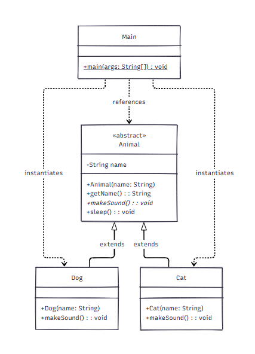

# PBO-Case-Study
## Name : Halis Ibrahim Kumala Chandra
## NIM : F1D02410049

## Class Diagram



---

## File Structure

- **`Animal.java`**: The abstract superclass defining base attributes and methods.
- **`Dog.java`**: A concrete subclass extending `Animal`.
- **`Cat.java`**: A concrete subclass extending `Animal`.
- **`Main.java`**: The application driver containing the `main` method.

---

## OOP Concepts Explanation

### 1. Abstraction
- Defined in `Animal.java`.
- `Animal` is declared with the `abstract` keyword, preventing direct instantiation (e.g., `new Animal(...)` is disallowed).
- It defines an abstract method:
  ```java
  public abstract void makeSound();
  ```
  This serves as an enforced blueprint that every derived class must implement with its own specific logic.

### 2. Inheritance
- Implemented in `Dog.java` and `Cat.java`.
- Both classes use the `extends Animal` clause to inherit:
  - The `name` field (accessed through `getName()`).
  - The concrete method `sleep()`.
- Both classes call `super(name)` in their constructors to pass the name parameter up to the `Animal` superclass.

### 3. Polymorphism (Dynamic Method Dispatch)
- Demonstrated in `Main.java`.
- Subclass instances are assigned to parent class reference variables:
  ```java
  Animal myDog = new Dog("Buddy");
  Animal myCat = new Cat("Luna");
  ```
- When `makeSound()` is invoked, Java dynamically decides at runtime which subclass method to execute based on the actual object created in memory, not the reference type.
- This also enables polymorphic collections, such as an `Animal[]` array containing different animal types, which can be iterated and manipulated uniformly:
  ```java
  Animal[] shelter = { myDog, myCat, new Dog("Rocky") };
  for (Animal animal : shelter) {
      animal.makeSound();
  }
  ```

---